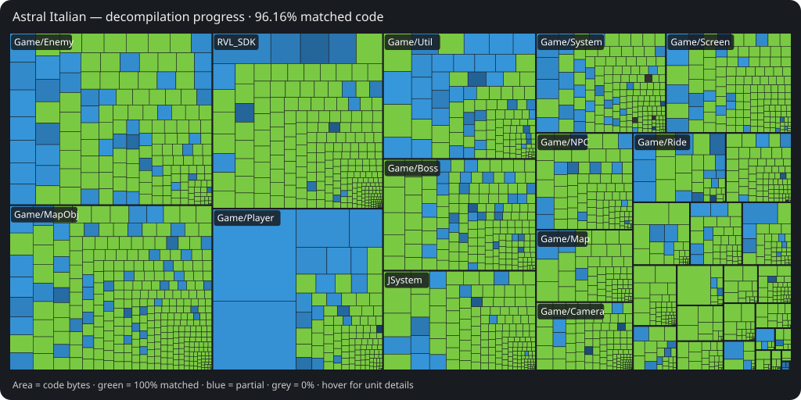

# Astral Italian

> [!IMPORTANT]
> **A private, AI-assisted fork of [SMGCommunity/Garigari](https://github.com/SMGCommunity/Garigari).**
> Not affiliated with or endorsed by Garigari or Petari, and not intended for upstream.
> **Please do not contact their maintainers or Discord about this fork.**

Regenerate after a Wii build: `python3 tools/team/progress_treemap.py build/SB4E01/report.json docs/images/progress-treemap.svg`.

## What this is

Astral Italian combines a Super Mario Galaxy 2 decompilation (USA Rev 0,
`SB4E01`) with a native macOS port for Apple Silicon. **No game assets are
included. You need your own disc.**

## Status

As of **2026-10-22**:

- **83.65% matched code** (5,244,504 / 6,269,292 bytes), **94.93% matched
  functions** (47,801 / 50,354), and **98.96% fuzzy match**. Matched code is
  different from fully completed/linked code, currently **1.50%**. These are
  local objdiff report numbers, not upstream's decomp.dev statistics.
- **5.2.1 with Cappy** is the default frozen build; **5.1** is the fallback.
  **5.3** is a frozen, non-default candidate. **5.3.2 source is on main**;
  its clean frozen release and full release gates are still pending. A
  `dev-20261022` drop is available through the frozen-build chooser.
- A player **cleared Yoshi Star Galaxy, collected its star and returned to
  Starship Mario** on 5.2.1. Flip-Swap and Fluffy Bluff have been played;
  Fluffy Bluff's Odyssey moves and Star Bit mods were player-confirmed.
  Flip-Swap completion is not established. Automated normal-route checks
  reached Sky Station mission 1 through file select, Starship and World 1's map.
- Coverage of free movement and mission completion is limited; this is not a
  full-game completion claim. **Switch 2 Pro Controller does not work yet**:
  macOS libusb/SDL integration needs work. There is no native Windows or Linux port.

Progress comes from the latest numeric entry in the team's `progress.log`
(2026-10-21 17:40) and the local report used for the treemap. Play coverage and
build status were checked against team reports and frozen-build receipts;
[PLAY.md](PLAY.md) describes the launcher.

## Play it

Read [PLAY.md](PLAY.md), then double-click
[Play Astral Italian.command](Play%20Astral%20Italian.command). The launcher
uses your privately extracted disc, normally
`~/MacioGalaxy2-gamedata/SB4E01-extracted/`.

Choose **c** for 5.2.1, **f** for 5.1, **n** for the 5.3 candidate, or **b**
for other available frozen builds. Choose a galaxy or the title screen;
Odyssey movement and audio have menu toggles. The launcher requires an app
with a `FROZEN.txt` marker under `~/MacioGalaxy2-play/`.

Normal saves, settings, mods and controls live in `~/MacioGalaxy2-play/user/`
(saves under `NAND/`); run logs are in `user/logs/`. The optional unlocked
save uses `~/Library/Application Support/AstralItalian-unlocked/`.
Builds can share saves and graphics caches. See the
[persistent-state inventory](native/play/PERSISTENT-STATE.md) for exact paths.

## Mods and menus

Open the Home menu with **grave/backtick (`)** or **F1** to change controls,
enable mods, or use **Level Select**. Optional mods are off until enabled:

- **Odyssey movement:** long jumps, dives, rolls, wall jumps and more.
- **Cappy:** enable both Odyssey movement and Cappy, then reload the stage.
  **R** throws the cap; cap contact can flip Flip-Swap panels. In current
  main/5.3.2 source, a cap bounce restores the airborne Spin; this fix is
  absent from frozen 5.3.
- **Collect-all-Star-Bits (G):** pulls eligible Star Bits in the current scene to Mario.
- **Shoot-nearest (V):** fires a Star Bit at the nearest eligible visible enemy in range.

Details: [Mods](native/MODS.md), [Controls](native/CONTROLS.md),
[Home menu](native/HOME_MENU.md), [Level Select](native/LEVEL_SELECT.md).

## Controls

| Action | Default keyboard / mouse |
| --- | --- |
| Move / jump / spin | WASD / Space / F |
| Crouch; ground pound in air | Shift |
| Star Pointer / shoot / hold pointer target | Mouse / left click / right click |
| Rotate / recenter camera | Q and E / C |
| Start / pause / Home menu | Return / Escape / grave (`) or F1 |
| Capture a playtest problem | M or F9 |

Xbox and PlayStation controllers use SDL gamepad input. Switch Pro layouts
use **Nintendo button labels**, with separate Galaxy and Odyssey layouts;
physical-pad validation remains limited. Switch 2 Pro is not supported yet.
See [CONTROLS.md](native/CONTROLS.md) for mappings, power-ups and remapping.

## How it is built

The Wii decompilation uses **decomp-toolkit (dtk), Ninja and objdiff**.
The upstream dependency, build and diffing instructions now live in
[Building the decompilation](docs/building-decomp.md).

The native port uses CMake and native platform replacements with
`GALAXY_NATIVE` hooks. [native/README.md](native/README.md) describes the
architecture and build setup; its opening status and imported SMG1 sections
are historical. Use [PLAY.md](PLAY.md) for current play instructions.

## How the work is done

AI agent teams work in separate worktrees with proof gates. Native hook
changes go through [hookproof](tools/team/hookproof.sh) and
[proofland](tools/team/proofland.sh): clean before/after Wii object builds
must be identical, with a perturbation control to check the proof itself.
The [crossed-dispatch oracle](tools/team/dispatchcheck.py) separately checks
bindings against the original DOL, catching wrong vtable or nerve targets
that byte matching can miss. Dispatch fixes have their own image-proof path.
[land.sh](tools/team/land.sh) serializes landings, rebases, checks and pushes;
its docs-only path skips the Wii build.

See the [team playbook](docs/team/TEAM.md) and
[dispatch/proof guide](docs/team/DISPATCH.md).

## Docs map

| Document | Purpose |
| --- | --- |
| [PLAY.md](PLAY.md) | Start playing; build choices and known issues |
| [Full play guide](native/play/PLAY.md) | Launcher options and troubleshooting |
| [Persistent state](native/play/PERSISTENT-STATE.md) | Saves, settings, logs and caches |
| [Controls](native/CONTROLS.md) | Keyboard, mouse, controllers and remapping |
| [Mods](native/MODS.md) | Optional movement and gameplay helpers |
| [Home menu](native/HOME_MENU.md) | Native menu and controls page |
| [Level Select](native/LEVEL_SELECT.md) | Galaxy/mission requests and their limits |
| [Wii build guide](docs/building-decomp.md) | Dependencies, building and objdiff |
| [Native port](native/README.md) | Architecture and build reference (historical status text) |
| [Team playbook](docs/team/TEAM.md) / [Dispatch checks](docs/team/DISPATCH.md) | Agent workflow and proof gates |

Credit to Garigari and Petari, and to the [doldecomp team](https://github.com/doldecomp),
[Zelda TP](https://github.com/zeldaret/tp) and [OGWS](https://github.com/doldecomp/ogws/tree/master)
for code and headers used by this project.
