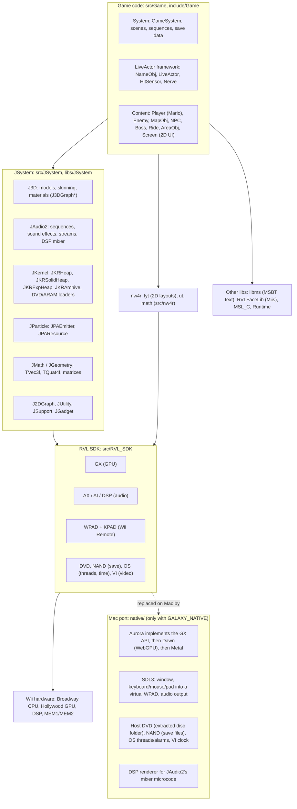
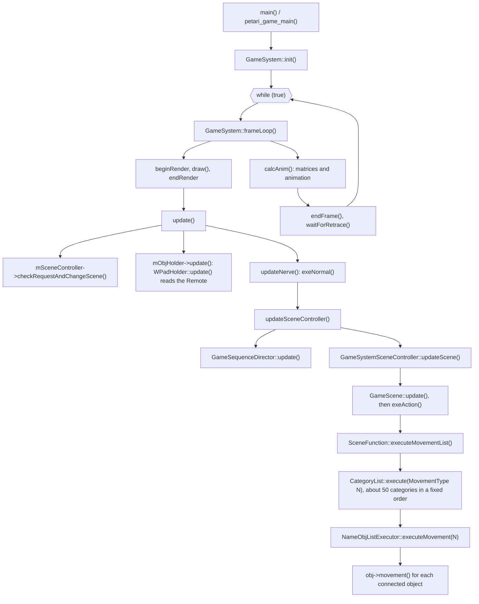
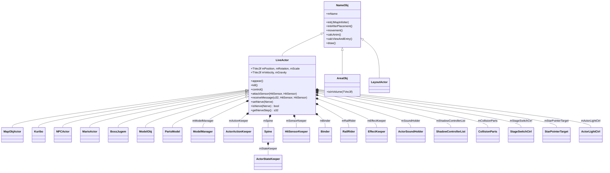
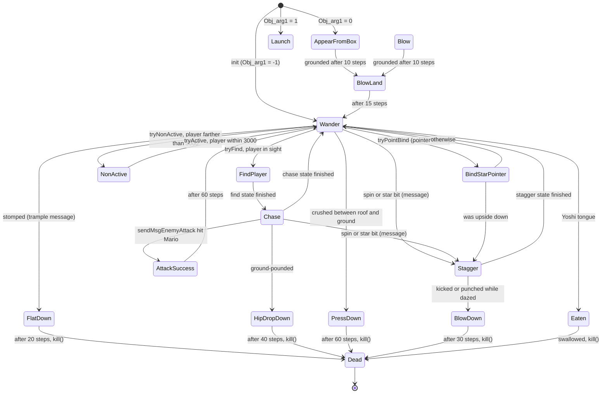
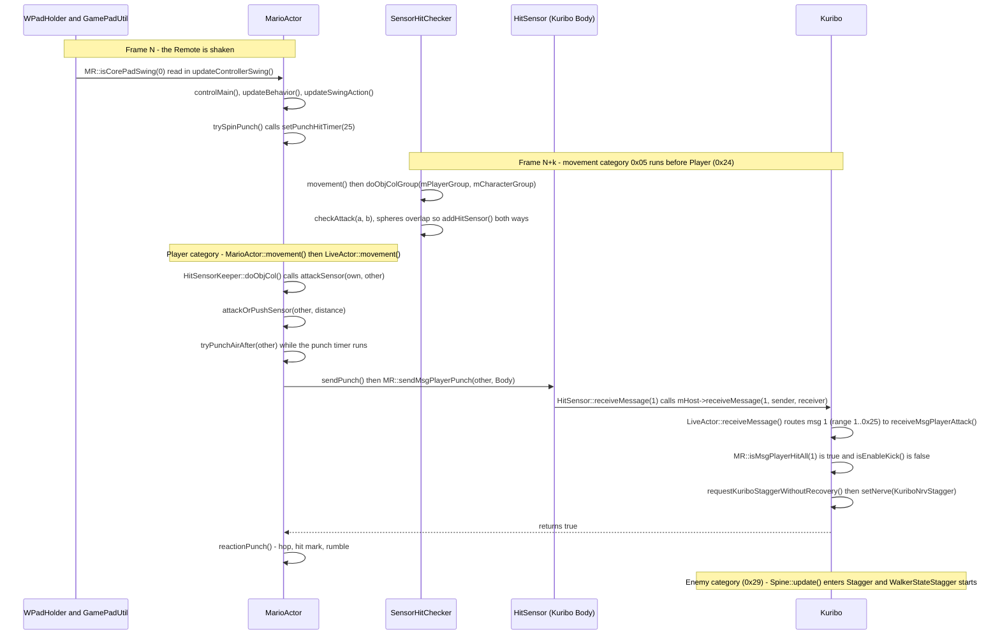
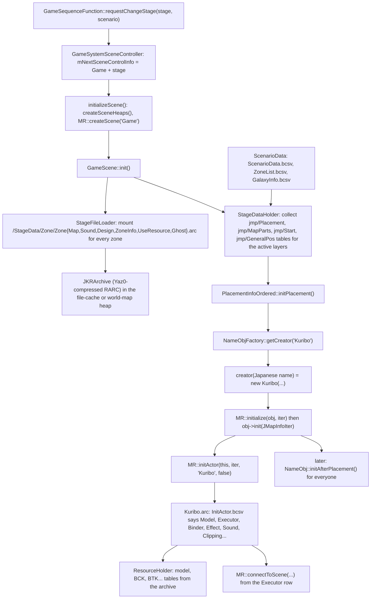
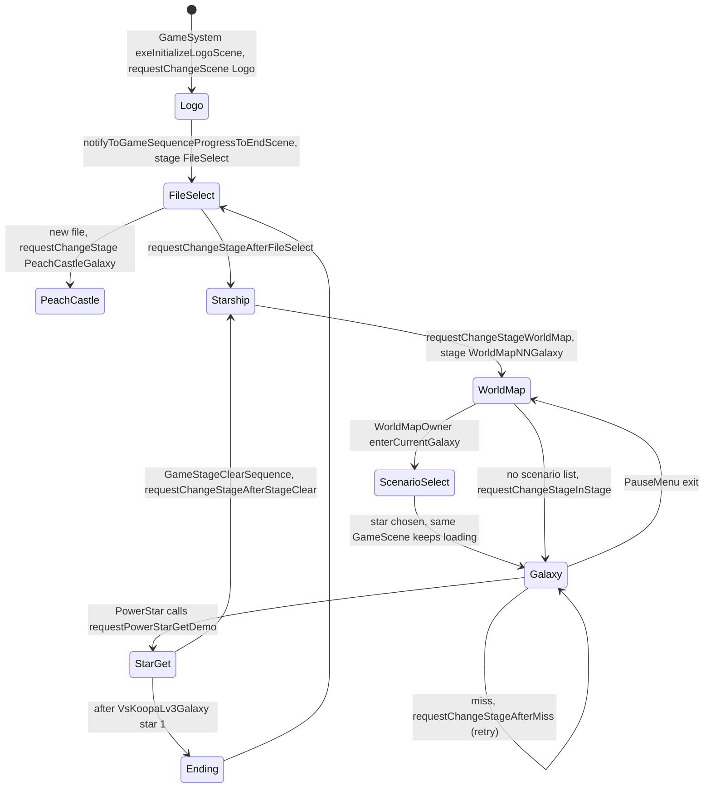
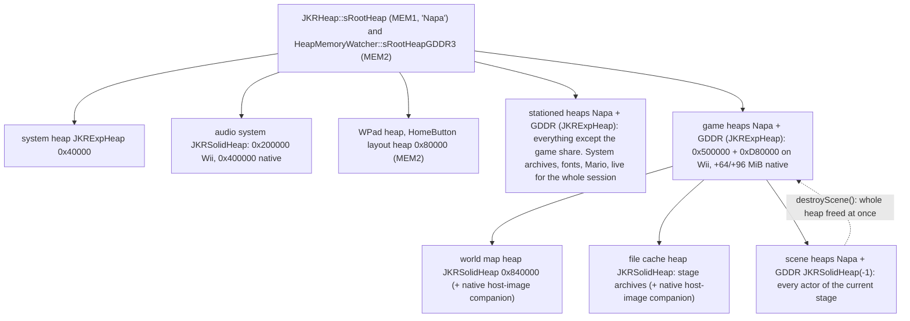
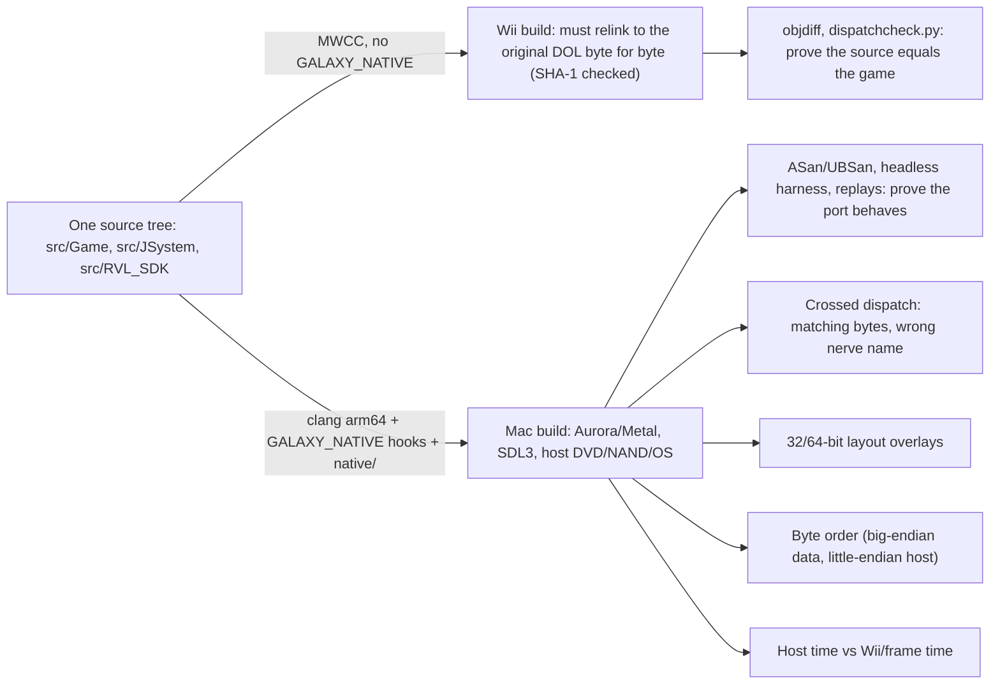

# How Super Mario Galaxy 2 is built: a guided tour of the Astral Italian decomp

Repo: `~/MacioGalaxy2` (commit `cb88a97a`). All paths below are relative to that root. Every class
and function named here was checked against the source. Where the picture is condensed, the text says
**simplified**.

## The big picture (5 lines)

1. The game is one C++ program. `main()` builds a `GameSystem` singleton and calls `GameSystem::frameLoop()` forever, once per 60 Hz video frame.
2. Each frame runs the current **Scene**. Only three scene classes can be created by name: `Logo`, `Game` and `Intermission`. The title/file select, the Starship, the world maps and every galaxy are all a `GameScene` loading a different *stage*.
3. Anything that lives in a scene is a `NameObj`. Things with a body (Mario, Goombas, platforms) are a `LiveActor`, which is a bag of optional components: model, hit sensors, ground collision ("Binder"), effects, sound, and a **Nerve** state machine.
4. Levels are data. Archives (`.arc`) hold BCSV tables saying "put a `Kuribo` here with these args". `NameObjFactory` turns each class name into a `new Kuribo(...)` and calls its `init()`. The actor then reads its own `InitActor.bcsv` to decide which components it needs.
5. Under the game code sit Nintendo's **JSystem** libraries (3D models, audio, particles, heaps and archives), **nw4r** (2D UI layouts) and the Wii **RVL SDK**. The Mac port keeps the game code and replaces only the bottom layer, behind `#ifdef GALAXY_NATIVE`.

---

## 1. Layers

**What each layer does.** The *game code* is everything written for SMG2 (and SMG1 before it). It never
talks to hardware directly. It calls JSystem for 3D models (`J3DModel`), sound (`JAISoundStarter` and
friends, wrapped by the game's `AudSystem`), particles (`JPABaseEmitter`, wrapped by `EffectSystem`),
memory (`JKRHeap`) and files (`JKRArchive`). 2D menus and the HUD use **nw4r::lyt** (`LayoutActor` holds
`nw4r::lyt::Pane`s). Under that sits the Wii SDK: GX for drawing, AX/DSP for audio, WPAD/KPAD for the
Remote, DVD for the disc, NAND for saves, OS for threads and clocks.

**What the port replaces.** The port changes the bottom layer and keeps everything above it.
- **Graphics:** Aurora (fetched in `native/gx/CMakeLists.txt`, with many `patch_aurora_*.py` patches)
  implements the GX calls on Dawn/WebGPU. `native/app/app_main.cpp` requests `BACKEND_METAL`.
- **Input:** `native/input/wpad_host.cpp` implements the WPAD API for a virtual Remote and Nunchuk. The
  SDK's own `src/RVL_SDK/kpad/KPAD.c` is compiled unchanged on top of it (`native/input/README.md`).
- **Audio:** `native/platform/audio/dsp_renderer.cpp` reimplements the DSP mixer behaviour and
  `native/audio/sdl_sink.cpp` sends the result to SDL3.
- **DVD/NAND/OS/VI:** `native/platform/{dvd,nand,os,vi}` (see `native/platform/STATUS.md`).
- **Hooks into the game:** `#ifdef GALAXY_NATIVE` blocks. There are about 1,100 of them in 375 files under
  `src/`. For example, `main` is renamed `petari_game_main` so the Mac app can call it
  (`native/app/platform_host.cpp`).

Refs: `src/Game/System/GameSystem.cpp`, `native/platform/STATUS.md`, `native/input/README.md`, `native/gx/CMakeLists.txt`

---

## 2. The frame

**One frame, in plain words.** `frameLoop` *draws first*, then updates, then computes animation matrices,
then waits for the next video retrace. So a frame shows what the previous frame's update produced. The
update step reads controllers (`GameSystemObjHolder::update()` calls `WPadHolder::update()`). Then
`GameSystem`'s own nerve runs (`exeNormal`), which updates the sequence logic and the current scene.

**Scenes.** `GameSystemSceneController` owns the current `Scene*`. It changes scenes with its own nerve
machine (`exeWaitDrawDoneScene`, `exeDestroyScene`, `exeInitializeScene`, `exeReadyToStartScene` and others).
`initializeScene()` creates the scene heaps, calls `MR::createScene(name)` and then `Scene::init()`. The name
lookup table in `SceneFunction.cpp` has exactly `{"Game", "Intermission", "Logo"}`. The controller also owns
two scenes that are always present and update alongside the current one: `ScenarioSelectScene` (the star
picker) and `ModelWipeScene`.

**Categories ("connect to scene").** Objects don't update themselves. They register into numbered
categories, and the scene walks the categories in a fixed order. `MR::connectToSceneEnemy(actor)` is just
`MR::registerNameObjToExecuteHolder(actor, 0x29, 0x8, 0x13, -1)`: movement category 0x29 (Enemy), calcAnim
category 8, draw-buffer 0x13, no direct draw. The order in `executeMovementList` is the frame's real
schedule: camera, then `SensorHitChecker` (0x05), then planets and map collision, then map objects, then
Player (0x24), then enemies (0x29), then layouts. `NameObjExecuteHolder` makes connect and disconnect requests
take effect at safe points (`executeRequirementConnectMovement` and the related calls). That is why an actor
that "appears" (`LiveActor::makeActorAppeared` calls `MR::connectToSceneTemporarily`) starts updating cleanly.
The `MovementType` *names* in `SceneFunction.hpp` were borrowed from SMG1 research (noclip), and a comment
there says some SMG2 ids differ. Trust the numbers more than the labels.

Refs: `src/Game/System/GameSystem.cpp`, `src/Game/System/GameSystemSceneController.cpp`, `src/Game/Scene/SceneFunction.cpp`, `src/Game/NameObj/NameObjExecuteHolder.cpp`, `src/Game/Util/ObjUtil.cpp`

---

## 3. The object model

**NameObj** is the root of every scene object. It has a name plus the virtual hooks the scene calls:
`init(const JMapInfoIter&)` (placement data in), `movement()`, `calcAnim()`, `calcViewAndEntry()`, `draw()`.
Non-physical things such as directors, cameras and managers are plain `NameObj`s. So are **AreaObj**s,
which are invisible volumes like `DeathArea`, `WaterArea` and `SwitchArea`, answering `isInVolume(pos)`.
`LayoutActor` (2D UI) is also a `NameObj`.

**LiveActor** adds a transform (`mPosition`, `mRotation`, `mScale`, `mVelocity`, `mGravity`, since gravity
points toward the nearest planet) and pointers to optional components. Each pointer is `nullptr` unless
that actor needs it:

| Component | What it does |
|---|---|
| `ModelManager` | owns the `J3DModel` and its animation players (BCK/BTK/BRK...) |
| `ActorActionKeeper` | maps an "action" name like `"Hit"` to animation, effects and sound together (`MR::startAction`) |
| `Spine` | the Nerve state machine (section 4) |
| `HitSensorKeeper` | named spheres (`"Body"`, `"Center"`...) used for contact (section 5) |
| `Binder` | collides the actor with level geometry (ground, walls, ceilings) |
| `RailRider` | follows a placed path ("rail") |
| `EffectKeeper` | particle emitters (`MultiEmitter`, built on JParticle) |
| `ActorSoundHolder` | positional sound object (`AudAnmSoundObject`, built on JAudio2) |
| `CollisionParts` | lets *others* stand on or collide with this actor (moving platforms) |
| `StageSwitchCtrl` | level-wide on/off switches (`MR::useStageSwitchSyncAppear`, `onSwitchDead`) |
| `ShadowControllerList`, `ActorLightCtrl`, `StarPointerTarget` | drop shadows, lighting, Wii-pointer targeting |

`LiveActor::movement()` drives them in a fixed order. In order: model update, gravity, `HitSensorKeeper::doObjCol()`
(deliver contacts), `Spine::update()` (run the current nerve), `control()` (per-class code), Binder,
action/effect keepers, sensor positions, sound, shadow. If the actor dies partway through, the rest of the
update is skipped.

**Main families:** `MapObjActor` (generic map objects), enemies directly on `LiveActor` (for example `Kuribo` in
`src/Game/Enemy/Kuribo.cpp`), `NPCActor` (Toads, Lumas), `MarioActor` (section 8), bosses (`BossJugem`).

Refs: `include/Game/NameObj/NameObj.hpp`, `include/Game/LiveActor/LiveActor.hpp`, `src/Game/LiveActor/LiveActor.cpp`, `include/Game/AreaObj/AreaObj.hpp`, `include/Game/MapObj/MapObjActor.hpp`

---

## 4. Nerves: the state machines everywhere

*(Simplified: message-driven transitions can fire from most "alive" nerves. Only a representative source
state is drawn for each. `Launch` has a hand-written `execute` whose exits are not shown.)*

**How it works.** A `Nerve` is a stateless singleton with one virtual function, `execute(Spine*)`. The
`NEW_NERVE(KuriboNrvWander, Kuribo, Wander)` macro defines a class whose `execute` casts the owner and calls
`Kuribo::exeWander()`. `NEW_NERVE_ONEND` also wires `executeOnEnd`, used by Kuribo's `NonActive` to turn
gravity back on. The `Spine` holds `mCurrNerve`, `mNextNerve` and `mStep`:

- `setNerve(n)` runs the old nerve's `executeOnEnd`, stores `n` as *next*, and sets `mStep = -1`.
- `Spine::update()` runs `changeNerve()` (commit next→current, `mStep = 0`), then `execute`, then `mStep++`,
  then `changeNerve()` again.
- So `MR::isFirstStep(this)` (step 0) is where code does one-time setup: start the animation, play a sound.
  `getNerveStep()`, `MR::isStep(this, 10)` and `MR::isGreaterStep(this, 20)` count frames spent in this state.
  That is why the game is full of literal frame counts.

Anything can have a nerve. `LiveActor` has one, and `NerveExecutor` gives one to non-actors (`GameSystem`, `Scene`,
`GameSequence`, `GameSystemSceneController`). **Sub-states:** `ActorStateBase<T>` is a reusable mini-state
machine with its own nerve. `MR::initActorState(this, mStateStagger, GET_NERVE(Kuribo, KuriboNrvStagger), "Stagger")`
registers it in the Spine's `ActorStateKeeper`, so entering the `Stagger` nerve automatically starts
`WalkerStateStagger`. `exeStagger()` then calls `MR::updateActorStateAndNextNerve(this, Wander)` until it reports
done. Kuribo shares its walking logic with other enemies this way: `WalkerStateWander`, `WalkerStateFindPlayer`,
`WalkerStateChase`, `WalkerStateStagger` and `WalkerStateBindStarPointer` live in `src/Game/Enemy/WalkerState*.cpp`.

**Kuribo's 17 nerves** (`namespace NrvKuribo`): NonActive, AppearFromBox, Launch, Blow, BlowLand, Wander,
FindPlayer, Chase, AttackSuccess, BindStarPointer, Stagger, FlatDown, HipDropDown, PressDown, BlowDown, Dead,
Eaten.

Refs: `include/Game/LiveActor/Nerve.hpp`, `src/Game/LiveActor/Spine.cpp`, `include/Game/System/NerveExecutor.hpp`, `include/Game/LiveActor/ActorStateBase.hpp`, `src/Game/Enemy/Kuribo.cpp`

---

## 5. Interaction: sensors and messages

**HitSensor.** A sphere (`mPosition`, `mRadius`) with a type (`mType`) and a host actor. Types are the
`ATYPE_*` constants in `include/Game/Util/ActorSensorUtil.hpp`: `ATYPE_PLAYER = 0x1`, `ATYPE_ENEMY = 0x18`,
`ATYPE_ENEMY_ATTACK = 0x1a`, `ATYPE_KURIBO = 0x1f`, `ATYPE_MAP_OBJ = 0x40`, `ATYPE_COIN = 0x44`,
`ATYPE_EYE = 0x7a`, and others. A comment there says several SMG2 values were derived by matching SMG1 usage
against the SMG2 assembly, with "votes", so a few are educated inferences.

**Two phases per frame.**
1. *Detection:* `SensorHitChecker` is itself a `NameObj` in movement category 0x05. It sorts sensors into six
   groups (Player, Ride, Eye, Simple, MapObj, Character) and tests only the pairs that matter
   (`doObjColGroup`). For each overlap, `checkAttack()` records each sensor on the other (`addHitSensor`).
   Eye sensors only look; they are never "hit".
2. *Delivery:* later in the same frame, each actor's `LiveActor::movement()` calls
   `HitSensorKeeper::doObjCol()`, which calls the host's **`attackSensor(mine, theirs)`** once per recorded contact.
   This is where the actor decides what the contact means.

**Messages.** The decision becomes a message: `MR::sendMsgPush`, `MR::sendMsgPlayerPunch`,
`MR::sendMsgEnemyAttack`, `MR::sendArbitraryMsg(id, ...)`. All of them call
`receiverSensor->receiveMessage(id, senderSensor)`, which forwards to the host's
`LiveActor::receiveMessage`. That function routes by number range: `0x33` goes to `receiveMsgPush`,
`1..0x25` to `receiveMsgPlayerAttack`, `0x5A..0x74` to `receiveMsgEnemyAttack`, and everything else to
`receiveOtherMsg`. Predicates such as `MR::isMsgPlayerSpinAttack(msg)` (`msg == 1`) or `MR::isMsgPlayerHitAll`
(a bitmask) let each enemy pick its reaction. The return value means "I accepted this", and the sender uses
it. For example, Kuribo's `attackSensor` calls `requestAttackSuccess()` only if `MR::sendMsgEnemyAttack`
to Mario returned true.

Refs: `include/Game/LiveActor/HitSensor.hpp`, `src/Game/LiveActor/SensorHitChecker.cpp`, `src/Game/LiveActor/HitSensorInfo.cpp`, `src/Game/Util/ActorSensorUtil.cpp`, `src/Game/Player/MarioActor.cpp` (`attackSensor`, `attackOrPushSensor`, `sendPunch`, `trySpinPunch`)

---

## 6. Building a galaxy

**Data first.** Global tables come from `/ObjectData/SystemDataTable.arc` (`GameSystemDataHolder::init`):
`GalaxyDataTable.bcsv`, `GalaxyWorldOrderList.bcsv`, `HeapSizeExcept.bcsv` and others. Each galaxy has
`/StageData/<Galaxy>/<Galaxy>Scenario.arc` containing `ScenarioData.bcsv` (stars and which *layers* are
active per star), `ZoneList.bcsv` (sub-areas) and `GalaxyInfo.bcsv` (`ScenarioData::initialize` in
`src/Game/System/ScenarioDataParser.cpp`). Save progress is separate: `GameDataHolder` holds event flags,
per-galaxy stars, player status and the world-map state. It serializes through `makeFileBinary` /
`loadFromFileBinary`.

**Archives and BCSV.** A `.arc` is a JKRArchive, a little filesystem, usually Yaz0-compressed
(`JKRDecomp`). A **BCSV** is a binary spreadsheet. `JMapInfo::attach(data)` wraps one, and a
`JMapInfoIter` points at one row. Placement rows have a class name, position/rotation/scale, `Obj_arg0..7`
(Kuribo reads `MR::getJMapInfoArg0WithInit` for "no gravity" and `Arg1` for how it appears), switch ids and
links.

**Factory.** `NameObjFactory::getCreator(name)` first checks the planet and "product map" creators, then
scans a 977-entry `{name, createFunc}` table (`cCreateTable`). Each create function is `new T(pName)`, and the
name passed in is the object's *Japanese* name from `ObjNameTable.tbl` (`MR::getJapaneseObjectNameOrNull`).
That is why debug names in the code are Japanese. Mario is placed separately by
`StageDataHolder::initPlacementMario()` and named `"マリオアクター"` ("Mario actor").

**Self-describing actors.** Inside `init`, `MR::initActor` opens the actor's own archive and reads
`InitActor.bcsv`. The rows `Model`, `Executor` (which `connectToScene` category), `Binder`, `Effect`, `Sound`,
`Clipping`, `GroupClipping`, `StarPointer` and `Light` decide which components get created. Extra files such
as `InitSensor.bcsv` and `InitCollision.bcsv` add sensors and collision. Much of an enemy's setup is
therefore data, not code. This is more data-driven than SMG1.

Refs: `src/Game/Scene/GameScene.cpp` (`GameScene::init`), `src/Game/Scene/StageFileLoader.cpp`, `src/Game/Scene/StageDataHolder.cpp`, `src/Game/Scene/PlacementInfoOrdered.cpp`, `src/Game/NameObj/NameObjFactory.cpp`, `src/Game/Util/ActorInitUtil.cpp`

---

## 7. Game flow and scenes

Everything after `Logo` in this diagram is one scene class, `GameScene`, loading a different stage.

*(Simplified: `requestChangeStageAfterStageClear` branches on special cases such as the first
IslandFleet clear and Bowser fights. In the code, its ordinary branch requests `MarioFaceShipGalaxy`; I
have not traced every later redirect.)*

**Who owns transitions.** There are two cooperating owners:
- **`GameSequence`** (owned by `GameSequenceDirector`, owned by `GameSystem`) is the "story" state machine.
  Its nerves are `SystemStart`, `Title`, `InGame` and `Ending`, each an `ActorStateBase`. `GameSequenceInGame`
  in turn has the states `MarioFace` (the Starship, `GameSequenceMarioFaceShip`), `WorldMap`
  (`GameSequenceWorldMap`), `InStage` (`GameSequenceInStage`) and `Opening`.
- **`GameSequenceFunction::*`** (`src/Game/System/GameSequenceFunction.cpp`) is the request API used by
  everything else. `requestChangeStage`, `requestChangeStageMarioFaceShip`, `requestChangeStageWorldMap`,
  `requestChangeScenarioSelect` and `requestChangeStageAfterStageClear` all end in `setupChangeStage()`.
  That writes `"Game"` plus the stage name into `GameSystemSceneController::mNextSceneControlInfo` and calls
  `requestChangeScene()`. The controller's nerve then tears the old scene down and builds the new one
  (section 2).

**Stages, not scenes.** The **Starship** is the stage `MarioFaceShipGalaxy`. World maps are
`WorldMap%02dGalaxy` (built with `snprintf` from `GameDataFunction::getCurrentWorldId()`) and are driven by a
`WorldMapOwner` scene object. The Starship's galaxy-map screen is `GrandGalaxyMap`, a `NerveExecutor` with
state classes like `GrandGalaxyMapStateWorldWarp`. The title/file screen is the stage `FileSelect`
(`FileSelector` actor). Its `requestChangeStageAfterFileSelect()` chooses PeachCastle (opening) or the
Starship. **ScenarioSelectScene** is not a separate stage. It is a permanent overlay scene that runs while
the `GameScene` loads, which is why `GameScene::init` waits for `MR::isScenarioDecided()` before placing actors.

Refs: `src/Game/System/GameSequence.cpp`, `src/Game/System/GameSequenceInGame.cpp`, `src/Game/System/GameSequenceFunction.cpp`, `src/Game/Scene/SceneFunction.cpp`, `src/Game/System/WorldMapResultTU11.cpp` (`WorldMapOwner::enterCurrentGalaxy`)

---

## 8. Mario

```mermaid
flowchart LR
    subgraph IN["Input"]
        K1["KPADReadEx (SDK, or native virtual Remote)"] --> K2["WPadHolder::updateReadDataOnly()"]
        K2 --> K3["WPad: mStick, mCorePadSwing (WPadHVSwing), mButton, mPointer"]
        K3 --> K4["MR::getPlayerStickX/Y, MR::isCorePadSwing (GamePadUtil.cpp)"]
    end
    subgraph ACT["MarioActor : LiveActor (the body in the world)"]
        A1["control() then control2() then controlMain()"]
        A2["updateControllerSwing(): spin request"]
        A3["updateBehavior(): updateSwingAction(), then Mario::update()"]
        A4["sensors, Binder, Yoshi, effects, sounds, attackSensor()"]
    end
    subgraph BRAIN["Mario : MarioModule (movement brain)"]
        M1["Mario::update(): walls, ground, inputStick(), physics"]
        M2["status stack _97C: top MarioState gets proc(Update)"]
        M3["no status: procJump() in the air, updateWalkSpeed() on the ground"]
    end
    subgraph STATES["MarioState subclasses"]
        S1["MarioSwim, MarioHang, MarioWall, MarioClimb, MarioSlider"]
        S2["MarioFlip, MarioSkate, MarioFoo, MarioTeresa, MarioRabbit"]
        S3["MarioDamage, MarioStun, MarioFaint, MarioWarp, MarioYoshiDash..."]
    end
    ANIM["MarioAnimator::change(name), e.g. Mario::changeAnimation(Japanese anim name)"]
    K4 --> A2
    K4 -->|"MarioActor::getStickValue()"| M1
    A1 --> A2 --> A3 --> M1 --> M2 --> STATES
    M1 --> M3
    M1 --> ANIM
    STATES --> ANIM
```

**Two halves.** `MarioActor` (a `LiveActor`, `include/Game/Player/MarioActor.hpp`) is Mario as the world sees
him: his sensors (`"Body"`, `"eye"`...), Binder, model and effects, Yoshi (`mYoshiHolder`), the "action table"
(`mActionTable1080`), and the code that turns contacts into attacks (section 5). It holds
`Mario* mMario`, `MarioAnimator* mMarioAnim`, `MarioEffect*` and `MarioConst*`. **`Mario`**
(`include/Game/Player/Mario.hpp`, a `MarioModule`) is the movement brain: walk speed, jump, wall/ground/ceiling
checks, gravity vectors, stick processing. `MarioModule` is a small base class that just keeps `mActor` and
offers shortcuts (`getPlayer()`, `getAnimator()`, `getGravityVec()`).

**Player states are not Nerves.** Mario uses his own system. `MarioState : MarioModule` has
`proc(msg)` with `MarioStateMsg_Start/Close/Update/Notice/Keep` and virtuals `start()`, `update()`, `close()`
and `postureCtrl()`. `Mario::changeStatus(state)` pushes a state onto a linked **stack** (`_97C` is the top
and each state's `_8` is the one below). `closeStatus` pops it. `getCurrentStatus()` reports the
`MarioStatus_*` id of the top (`include/Game/Player/MarioState.hpp` lists 0x00 None ... 0x29 YoshiDash). Each
frame, `Mario::fn_80388DB0()` (still unnamed) sends `MarioStateMsg_Update` to the top state if there is one.
Otherwise it runs normal air or ground movement.

**Input to movement.** `WPadHolder` reads KPAD once per frame. `GamePadUtil` exposes it as
`MR::getPlayerStickX()` and `MR::isCorePadSwing(0)`. `MarioActor::getStickValue()` hands the stick to
`Mario::inputStick()` (scaled ×1.5 and clamped to ±1). Shakes go through
`MarioActor::updateControllerSwing()` → `isRequestRush()` → `trySpinPunch()`. Animation names are Japanese
strings, for example `"空パンチ"` (air punch) and `"ランニングキック"` (running kick), resolved by
`MarioAnimator`. A curiosity: `Mario::update()` still contains a string of bare `OSGetTime()` calls whose
results are thrown away, leftover profiling probes that the decomp reproduces faithfully.

Refs: `src/Game/Player/MarioActor.cpp`, `src/Game/Player/Mario.cpp` (`Mario::update`, `inputStick`), `src/Game/Player/MarioState.cpp`, `src/Game/System/WPadHolder.cpp`, `src/Game/Util/GamePadUtil.cpp`

---

## 9. Memory and resources

**Heaps.** The Wii has 24 MB of fast MEM1 (the code calls it "Napa") and 64 MB of MEM2 ("GDDR3"), and
the game is built around never fragmenting them. `JKRExpHeap` is a normal malloc-style heap. `JKRSolidHeap`
is a bump allocator: allocation is a pointer increment, nothing can be freed individually, and the whole
heap is discarded at once. `HeapMemoryWatcher` builds the tree above at boot. A scene change
(`GameSystemSceneController::destroyScene` → `destroyHeaps`) throws the scene heaps away wholesale, which is
why actors rarely free anything. `new` goes to whichever heap is "current", switched with
`setCurrentHeapToSceneHeap()` / `setCurrentHeapToStationedHeap()`. `ResourceHolder` indexes an archive's
models and animations (`initializeArc`: `.bdl/.bmd`, `.bck`, `.btk`, `.brk`, `.btp`, `.bva`...), and
`ResourceHolderManager` caches one holder per archive.

**Why sizes mattered for the port.** The Wii sizes are tight, and three things make everything bigger
on a Mac:
1. **64-bit pointers.** Every object with pointers grows. The SMG2 audio banks overflowed the Wii's 0x200000
   audio heap at bank 45, so native uses 0x400000 (comment in `HeapMemoryWatcher::createHeaps`). The world
   map and file cache heaps get a `cWorldMapNativeAllowance` / `cFileCacheNativeAllowance`.
2. **Byte order.** J3D model and animation files are big-endian. `J3DModelLoaderDataBase::load` calls
   `getHostModelImage()`, which makes a converted host-layout copy. That copy has to live somewhere, so the
   native build adds sibling "host image" heaps the same size as the file cache and world map heaps
   (`mFileCacheHostImageHeap`, `mWorldMapHostImageHeap`). A reproduced overflow: the Yoshi-to-Starship return
   filled the Wii-sized world map heap with these copies.
3. **32-bit offsets between arenas.** Some texture records store signed 32-bit offsets across MEM1 and MEM2,
   so the port reserves one 512 MiB range: 128 MiB MEM1, a guard gap, then 256 MiB MEM2 at +0x10000000
   (`docs/port/native-arena-layout.md`).

When a heap does run out, the native `memoryErrorCallback` names the heap and its sizes, where the Wii
just panics silently.

Refs: `src/Game/System/HeapMemoryWatcher.cpp`, `src/Game/System/GameSystemSceneController.cpp` (`createSceneHeaps`, `destroyHeaps`), `src/Game/System/ResourceHolder.cpp`, `src/JSystem/J3DGraphLoader/J3DModelLoader.cpp`, `docs/port/native-arena-layout.md`

---

## 10. Where the decomp and the port meet

**The contract.** The same `.cpp` files build two ways. The Wii build (Metrowerks compiler) must link back
to the original `main.dol`, which proves the C++ is a faithful translation. The Mac build adds
`#ifdef GALAXY_NATIVE` hunks that may not change the Wii objects. The commit
`cafee907` "native hooks (core): transfer MacioGalaxy GALAXY_NATIVE hooks ... (Wii objects byte-identical)"
shows the rule in practice. It was reverted when fresh Wii builds failed (`80f2e0e2`) and redone as `e146ed09`. Typical hooks: the entry point rename; `petari_os_preemption_point()` in
`GameScene::init`'s busy-wait loops, because the Wii's interrupts would have let a higher-priority loader
thread run and the host scheduler needs an explicit yield; `petari_gx_sync_wait_tokens_delivered()` at the
end of `frameLoop`; the Level Select warp in `GameScene::update`; and the Cappy/Odyssey movement mods in
`MarioActor::updateSwingAction`.

**Bug classes, with one real example each from `git log`:**

- **Crossed dispatch.** The Wii bytes match, but the source names the wrong nerve. Nerve instances are
  4-byte objects in `.sbss`, so swapping two names still produces identical code. Commit `2116765d` "BossJugem:
  bind angry-smoke checks to the original nerve (DISPATCH)": `BossJugem::control()` tested `BossJugemNrvSleep`
  where the game tests `BossJugemNrvAngry`, and the Angry instance had been left as an anonymous `lbl_807D1058`.
  A Wii relink cannot catch this, but it changes native behaviour (the smoke effect). The oracle that found it is
  `tools/team/dispatchcheck.py` (`docs/team/DISPATCH.md`, commit `410e643a`).
- **32/64-bit layout overlays.** Commit `c6cf8bf6` "native: grand galaxy map world warp gets a real
  PartsWarpInfo (WorldMap255Galaxy crash)": `GrandGalaxyMapSequence::exeWait` passed the
  `GrandGalaxyMapStateWorldWarp` object itself as a `PartsWarpInfo`, relying on the Wii layout where the warp
  fields sit at +0x10/+0x14 after a 16-byte `ActorStateBase`. With 8-byte pointers the header is wider, the warp id
  stayed −1, the game requested "WorldMap255Galaxy", and `GameScene::init` dereferenced null scenario data. A
  related example: `NameObjFactory.cpp` declares Wii-sized stand-ins (`class Kuribo { u8 _[0xd0]; }`) that would
  under-allocate on the host, so `NameObjFactoryNative.cpp` builds the real classes.
- **Byte order.** Commit `16ca624a` "Fix native star piece palette byte order": `StarPieceScatter::init` did
  `mColor = *reinterpret_cast<const GXColor*>(&color)` on a packed `u32`. That gives RGBA on big-endian PPC and ABGR on
  arm64, so star bits came out the wrong colours. Natively it now uses `Color8(color)`. The same class covers J3D,
  audio-bank and MSBT text conversion (`66f3187d`, `c6985c96`).
- **Host time vs Wii/frame time.** Commit `17e6b72d` "... fix native clocks": on the Wii, the bus clock is
  read from a fixed hardware address (`__OSBusClock` at `0x800000F8`, `OS_BUS_CLOCK_SPEED`), and every
  tick-to-time conversion (`OS_TIME_SPEED`, `OSNanosecondsToTicks`) divides by it. The native headers had
  copied this naively. `OS_BUS_CLOCK_SPEED` became an ordinary zero-initialised variable, and `__OSBusClock`
  was initialised to the *address* `0x800000F8` as if it were the value. The fix (new
  `libs/RVL_SDK/include/revolution/os/OSClock.h`) defines the real 243 MHz bus clock for non-Wii builds. This
  matters for the code that measures wall time with `OSGetTime` (for example `AudRhythmHolder`). Most
  gameplay instead counts *frames* (nerve steps), so frame pacing is the other half: natively VI follows the
  display at 60.00 Hz instead of the Wii's 59.94 (`native/README.md`, "Frame pacing"). The headless harness
  also had to stop host I/O latency from moving events between frames (`21933226` "native: order virtual
  async delivery after the first ready-scene reload", `docs/port/headless-virtual-io.md`).

Refs: `docs/team/DISPATCH.md`, `src/Game/System/GrandGalaxyMapSequence.cpp`, `src/Game/MapObj/StarPieceScatter.cpp`, `libs/RVL_SDK/include/revolution/os/OSClock.h`, `docs/port/HAZARDS.md`

---

### Where to start reading

1. `src/Game/System/GameSystem.cpp`: `main`, `frameLoop` (about 100 lines, the whole skeleton).
2. `src/Game/LiveActor/Spine.cpp` + `include/Game/LiveActor/Nerve.hpp`: the state machine (about 60 lines).
3. `src/Game/Enemy/Kuribo.cpp`: a complete, readable enemy using everything above.
4. `src/Game/Scene/GameScene.cpp` (`GameScene::init`): the stage-loading recipe in order.
5. `src/Game/System/GameSequenceFunction.cpp`: every "go to X" in the game.
